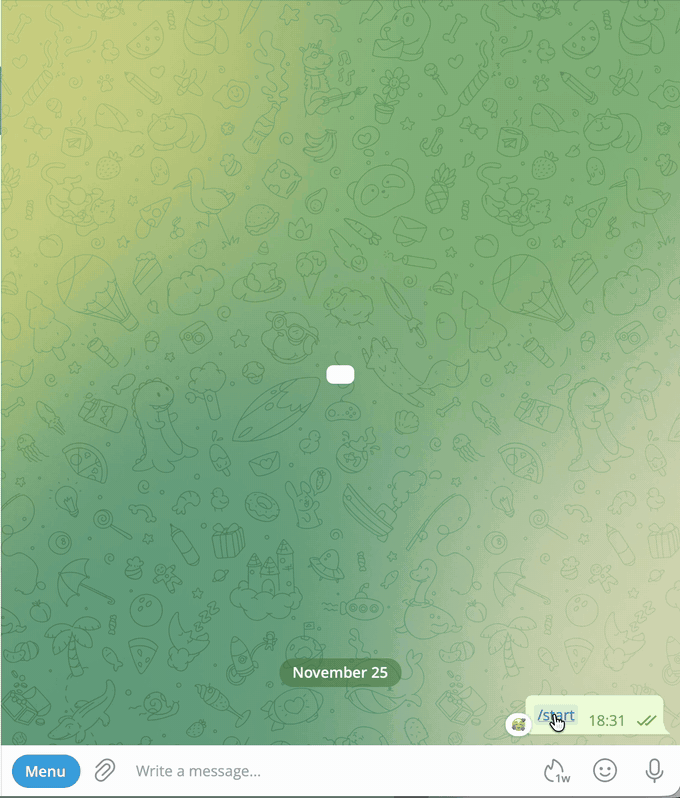
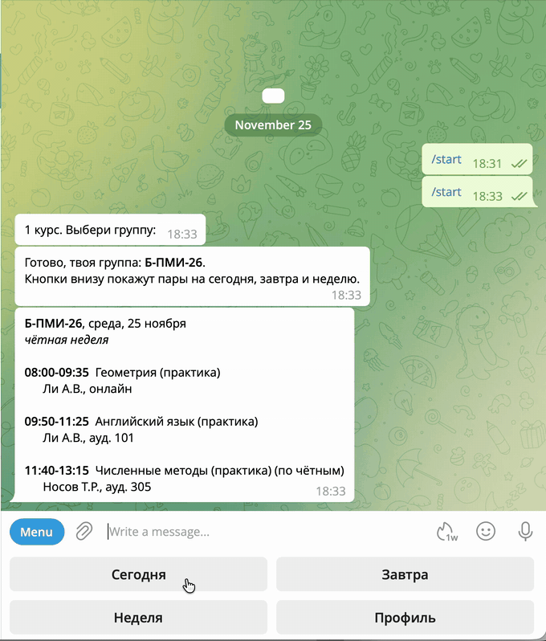
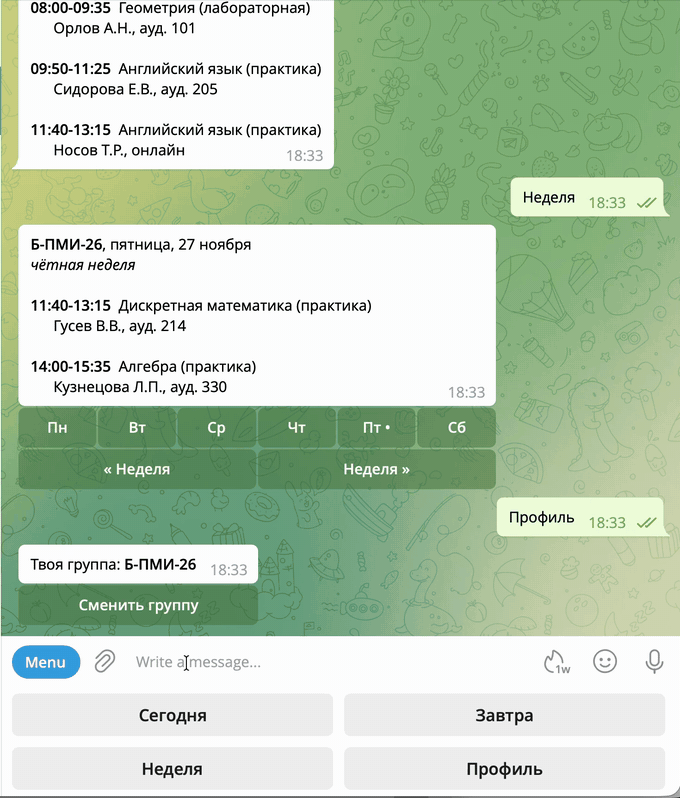

# telegram-bot-showcase

Telegram-бот с расписанием пар на aiogram 3. Это демонстрационная версия, по которой видно, как я строю ботов: регистрация, кнопки, свободный текст, inline-режим, метрики, проверка живости, тесты без настоящего Telegram, Docker и CI.

Данные выдуманы. Формат расписания тот же, что выдаёт [excel-schedule-normalizer](https://github.com/YaNTCN/excel-schedule-normalizer), так что вместе они собираются в цепочку «файлы вуза -> таблица -> бот».

Регистрация: курс и группа кнопками, сразу расписание на сегодня.



Меню и неделя: дни переключаются кнопками в том же сообщении.



Свободный текст: расписание любой группы на любой день.



## Кейс: бот расписания для университета

Живой бот: [@paralar_bot](https://t.me/paralar_bot).

**Задача.** Студенты смотрели расписание в Excel-файлах на сайте вуза: на телефоне неудобно, а изменения легко пропустить. Нужен бот, который знает группу студента и сразу показывает пары.

**Сложность.**

- Больше 20 институтов, у каждого свой формат файлов (это отдельный кейс: [парсер](https://github.com/YaNTCN/excel-schedule-normalizer)).
- Чётные и нечётные недели, подгруппы, пары с датами начала и конца, потоки на несколько групп.
- Студенту нужны не только кнопки: он пишет «завтра», «пт», «12.12», название чужой группы, фамилию преподавателя, номер аудитории.
- Бот работает на домашнем сервере без белого IP, а парсер на отдельном VPS. Падение любой части надо заметить раньше пользователей.
- Я один на поддержке, поэтому всё должно чиниться без меня или сразу сообщать, что сломалось.

**Решение.**

- Бот и фоновый воркер на aiogram 3, MongoDB, FSM хранится в базе и переживает перезапуск.
- Бот никогда не ходит к парсеру напрямую: воркер по расписанию синхронизирует кэш, и при сбое парсера бот продолжает отвечать.
- Возможности для студентов: расписание на день и неделю, друзья, личные правки расписания со ссылкой «поделиться», поиск преподавателя и аудитории, inline-режим, справка по каждой команде, жалоба на ошибку в расписании с картинкой исходной таблицы.
- Мониторинг: Prometheus и Grafana, трейсы в Tempo, алерты в Telegram по уровням важности, внешний контроль доступности с другого сервера, ежедневные бэкапы с проверкой восстановления.
- Деплой: push в `main` -> тесты в GitHub Actions -> self-hosted runner собирает и перезапускает контейнеры.

**Результат.**

- Около тысячи студентов пользуются ботом с начала 2026 года.
- 20+ институтов, почти 800 групп.
- Около 870 автотестов у бота, деплой без ручных шагов.
- Сбои видны на дашбордах и в алертах раньше, чем приходят жалобы.

Боевой код закрыт. По запросу могу показать его на созвоне.

## Что есть в этой версии

| Что | Где в коде |
|---|---|
| Регистрация: курс кнопкой, группа кнопкой или текстом («ивт 26»), «« Назад» | `bot/handlers/registration.py` |
| Меню на reply-клавиатуре: сегодня, завтра, неделя, профиль | `bot/keyboards.py` |
| Неделя одним сообщением: дни переключаются кнопками без новых сообщений | `bot/handlers/schedule.py` |
| Свободный текст: «завтра», «в пятницу», «12.12», «пми-26 завтра» | `bot/dates.py`, `bot/schedule.py` |
| Чётные и нечётные недели, текущая пара ▶️ и следующая ⏭ | `bot/schedule.py`, `bot/texts.py` |
| Inline-режим: `@бот Б-ИВТ-26 завтра` в любом чате | `bot/handlers/inline.py` |
| Кнопки на `CallbackData` с префиксами, без разбора строк вручную | `bot/keyboards.py` |
| Зависимости (расписание, база, часы) передаются в обработчики через контекст диспетчера | `bot/app.py` |
| Ограничение частоты сообщений, предупреждение один раз на серию | `bot/middlewares/throttling.py` |
| Метрики Prometheus по каждому обработчику: число, длительность, ошибки | `bot/middlewares/stats.py`, `bot/metrics.py` |
| `/healthz` и `/metrics` на отдельном порту | `bot/health.py` |
| Общий обработчик ошибок: запись в лог, метрика, вежливый ответ пользователю | `bot/app.py` |
| Админская команда `/stats` с фильтром по ID | `bot/handlers/admin.py` |
| Профили в SQLite (aiosqlite) | `bot/storage.py` |
| Все тексты в одном модуле, HTML с экранированием данных | `bot/texts.py` |
| Docker-образ без root, healthcheck, порт мониторинга только на localhost | `Dockerfile`, `docker-compose.yml` |

## Запуск

1. Получите токен у [@BotFather](https://t.me/BotFather). Для inline-режима включите его там же командой `/setinline`.
2. Создайте `.env` по образцу `.env.example` и впишите `BOT_TOKEN`.
3. Запустите:

```bash
docker compose up -d --build
curl http://127.0.0.1:8080/healthz
```

Без Docker (Python 3.11+):

```bash
pip install -r requirements.txt
python -m bot
```

Своё расписание: положите JSON в формате `data/schedule.json` и укажите путь в `SCHEDULE_PATH`. Демо-данные пересоздаёт `python scripts/make_demo_data.py`.

## Тесты

```bash
pip install -r requirements-dev.txt
pytest
```

В тестах работает настоящий `Dispatcher` со всеми роутерами и слоями, а вместо Telegram стоит сессия, которая записывает вызовы API (`tests/conftest.py`). Тест отправляет сообщение или нажимает кнопку и проверяет, что именно бот отправил в ответ: текст, клавиатуру, редактирование сообщения. Время подменяется, поэтому «сегодня» в тестах всегда одна и та же дата.

## Нужен бот?

Сделаю Telegram-бота под вашу задачу: запись и расписания, каталог, уведомления, приём заявок, интеграция с таблицами, CRM или вашим API. С тестами, мониторингом и деплоем на ваш сервер.
